# Audit: Tournament pages (Tournaments list and event page)

Piece: Meta tab follow-up (branch `tournament-pages`). Inventory entry: none, a new page set.
Intake entry: none.

The Meta tab's Tournaments row opens `#/meta/events`, the recent official events with each
champion's six. A card opens `#/meta/events/<id>`: the dates and battle count, a Watch row per
broadcast day, then every player seen on stream by finish. One player opens at a time
(`?p=<screen name>`): their six, the threes to build, and every game with its own Watch link.

The captures read a synthetic event (`fixtures/tournament-sample.json`, invented screen names)
through a stubbed `/api/v1/events`. `screens.mjs` shifts the event's dates so it ended four days
before each run, so the captures do not drift with the clock (the list shows only events that
ended within 55 days). `HOLLOWPINE` has no RK9 team list on purpose
(`fixtures/make-tournament.ts`), for the no-roster state.

## Screenshots

Dark and light at 390px, one pair per state, from the `npm run web:audit` run of 2026-10-19,
converted to WebP (600px wide, quality 72).

| State | Dark | Light |
| --- | --- | --- |
| `tournaments`: the list, one card with the champion and their six |  | 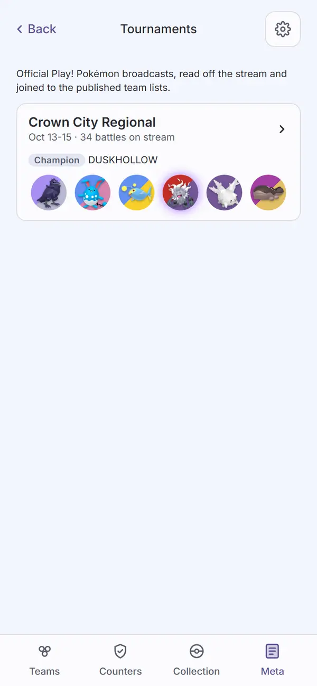 |
| `event`: dates, two Watch rows (day 3 has no VOD), the players by finish, all shut | 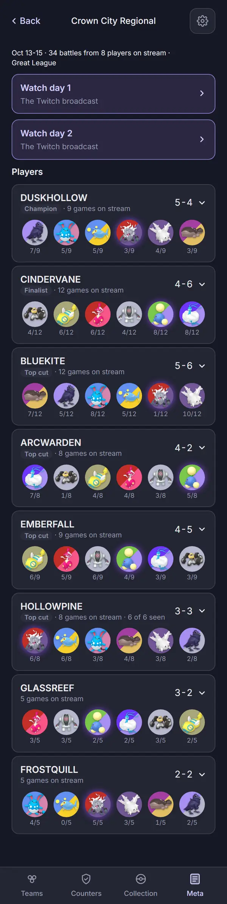 | 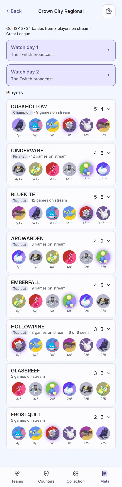 |
| `event-player-open`: ARCWARDEN open (`?p=`): their six, the threes to build, movesets from the team list | 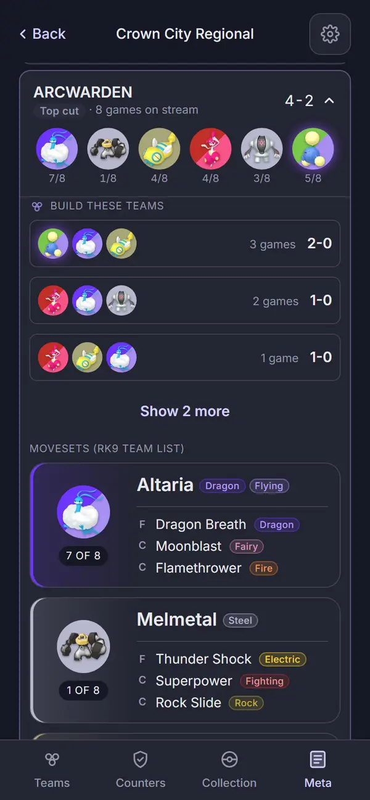 | 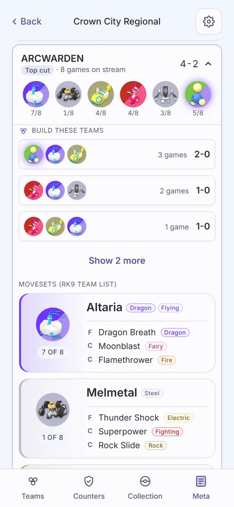 |
| `event-player-no-roster`: HOLLOWPINE open: "No team list yet", picks game by game with Watch links | 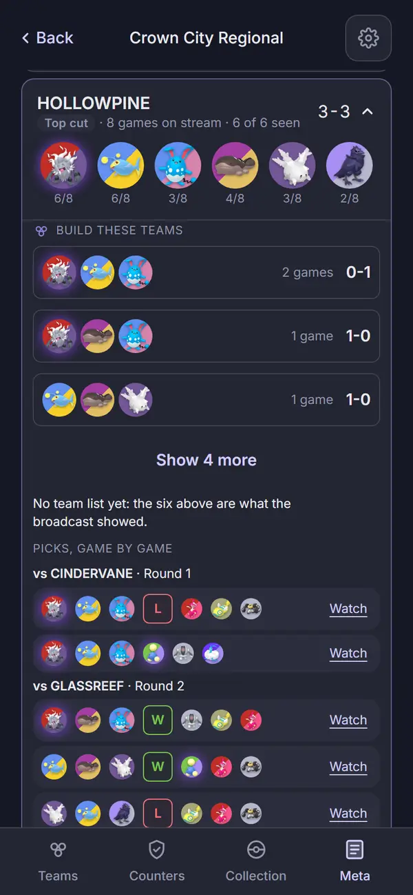 | 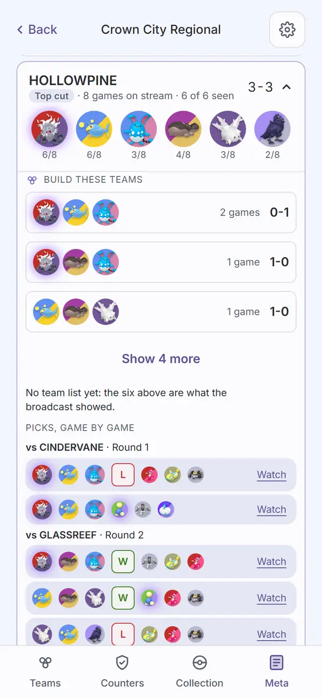 |

## Automated checks

- [x] `npm run web:audit` clean for this page's screens (`tournaments`, `event`,
      `event-player-open`, `event-player-no-roster`, all added to `AUDIT_ENFORCED`): exit 0, no
      finding on any of the four in either theme. The first run found 36x17 tap targets on the
      per-game "Watch" links; fixed in `.game-watch` (`apps/web/src/app.css`, a 44px target that
      takes no more row height) and re-run clean.
- [x] no console errors: `npm run web:screens` finished with no browser errors.
- [x] `npm run lint`, `npm run typecheck`, `npm run check-colors`, `npm run check-tokens` clean.
      `npx vitest run --project @pickthree/counter --project engine` after the fixture change: 92
      files, 833 passed, 1 skipped.

## Aesthetics

- [ ] colors from tokens, in their roles (violet interaction, pink measured with its mark,
      outcome colors, red only for destroying data)
- [ ] at most four text levels, one page title
- [ ] one filled primary button
- [ ] chips tapped, tags read
- [ ] the right header variant
- [ ] rows align; gutters and the 8px base hold
- [ ] sprites unchanged
- [ ] at most one line of text before the first result
- [ ] light as readable as dark

## Functionality

- [ ] every control does what its label says (Watch rows and per-game Watch open the right VOD at
      the right time; Build these teams opens Build)
- [ ] back returns to the origin with the open player and scroll
- [ ] no Watch links on an event older than 55 days, none for a day with no VOD
- [ ] icon buttons named; focus visible
- [ ] product rules: collection stays on the device, `connect-src` unchanged, no real tournament
      data
- [ ] tests cover the new behavior

## Findings and fixes

| Finding | Fix | Commit |
| --- | --- | --- |
| Per-game Watch links were 36x17 tap targets | `.game-watch` 44px target, negative block margin | Task 8 commit |

## Sign-off

- [ ] Travis, <date>

## Addendum: clarity pass (2026-10-19, unsigned)

Branch `tournament-pages-clarity`. Approved by Travis 2026-10-19 as a small clarity pass on the
signed pages; built from the same signed parts and tokens, no new color literals.

Changes:

1. Under "Players", one `tb-fine` line says what the numbers count: "Records are games won and
   lost on stream. 14/15 under a Pokémon: picked in 14 of the player's 15 streamed games." A
   player card's head reads "N streamed games".
2. List cards read "N streamed battles".
3. Each "Build these teams" row ends in the action-row `Chevron`, under one `small muted` line,
   "Tap a team to open it in Build." Games then record, as before.
4. Picks, game by game: one heading per match (`vs <opponent> · <round>`), then one row per game,
   `G<n>` in game order: own three, W/L chip (none when undecided), the opponent's three, Watch.
   The threes keep no lead order.
5. Watch is a play action: a `currentColor` play triangle plus "Watch", same 44px target and
   `aria-label`. The "Watch day N" rows lead with the same triangle.
6. "No team list yet: these are the Pokémon picked on stream. A ? is a Pokémon never picked on
   stream, not a missing one." sits directly under the open card's six (players without a team
   list only), as muted fine print (`tb-fine muted`). The "?" sentence shows only when a slot is
   unseen (fewer than 6 seen); HOLLOWPINE in the captures shows 6 of 6, so just the first.
7. Ongoing: `eventOngoing` (`@pickthree/engine/meta`) is true while the viewer's local date is on
   or before the end date. A `Tag` "Ongoing" leads the list card's dates line and the event page's
   facts line, and while ongoing each event day with no matches gets a `tb-fine` "Day N: no games
   yet".

Captures (dark and light, 390px unless named narrow, from the `npm run web:audit` run of
2026-10-19). `tournaments-ongoing` and `event-ongoing` are new, enforced captures: `screens.mjs`
moves the same synthetic event to end tomorrow (flag `pick3.eventOngoing`), so days 1 and 2 have
games and day 3 has none yet.

| State | Dark | Light |
| --- | --- | --- |
| `event-player-open`: chevrons and the tap hint on Build these teams | 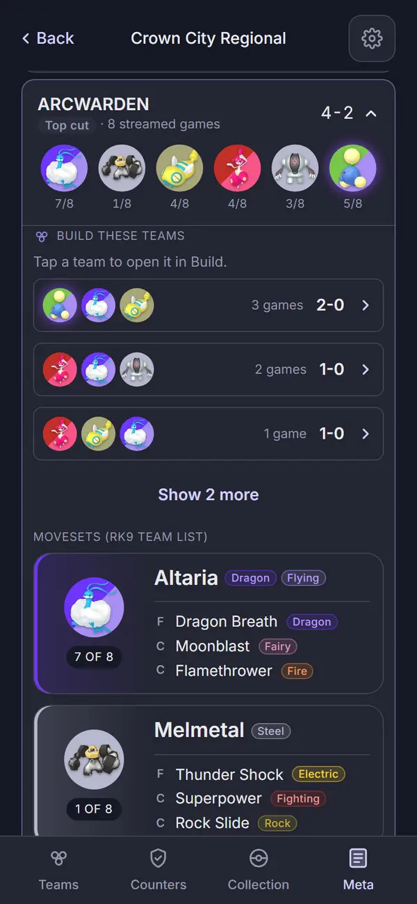 | 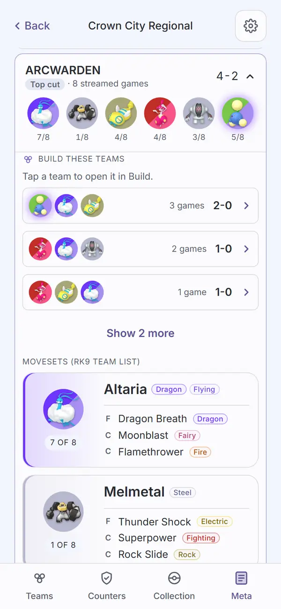 |
| `event-player-no-roster`: the note under the six, G1/G2 rows, play glyph Watch | 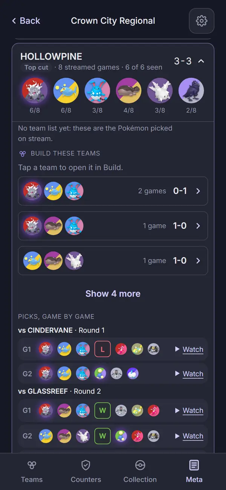 | 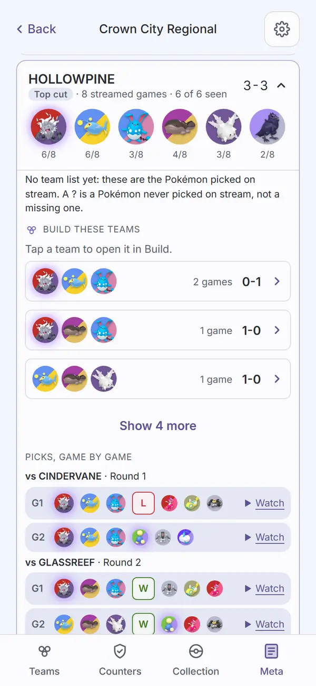 |
| `event-player-no-roster-narrow` (320px): Watch wraps to its own line under a game row | 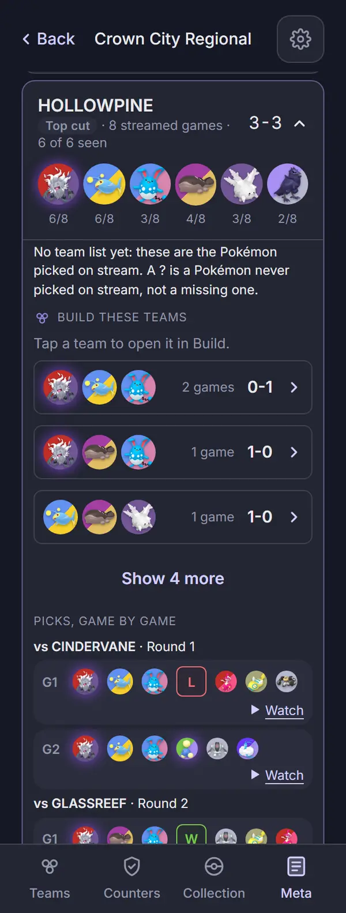 | 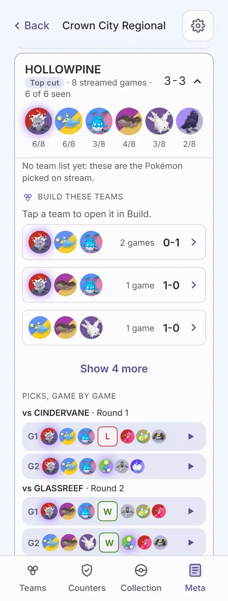 |
| `tournaments-ongoing`: Ongoing tag, streamed battles | 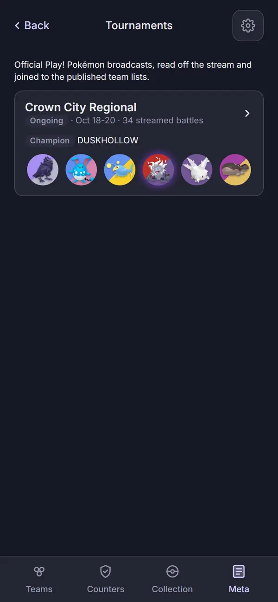 | 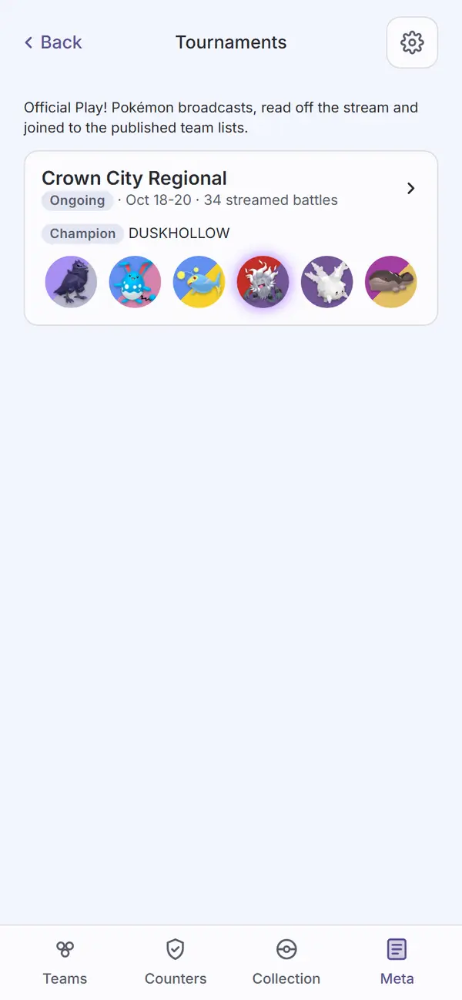 |
| `event-ongoing`: Ongoing in the facts line, "Day 3: no games yet", the Players line | 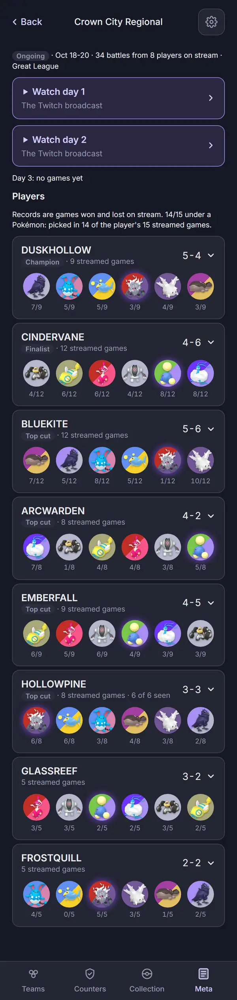 | 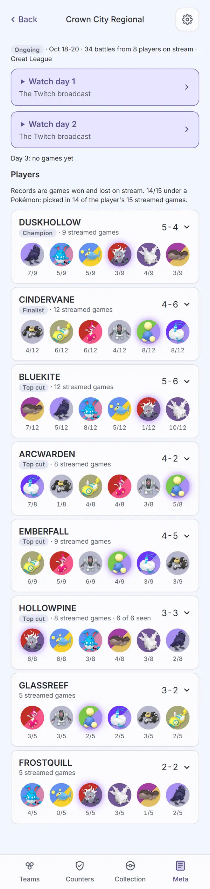 |

Automated checks: `npm run web:audit` exit 0 with no finding on any tournament screen in either
theme; `npm run web:screens` exit 0; lint, typecheck and check-colors clean; web 960 tests and
engine `events.test.ts` 23 tests pass.

Open for review: at 320px a game row (G label, two threes, chip, Watch) no longer fits on one line, so Watch
wraps under it (the row's `flex-wrap`). Seen on rows with and without a chip.

- [ ] Travis, <date>
